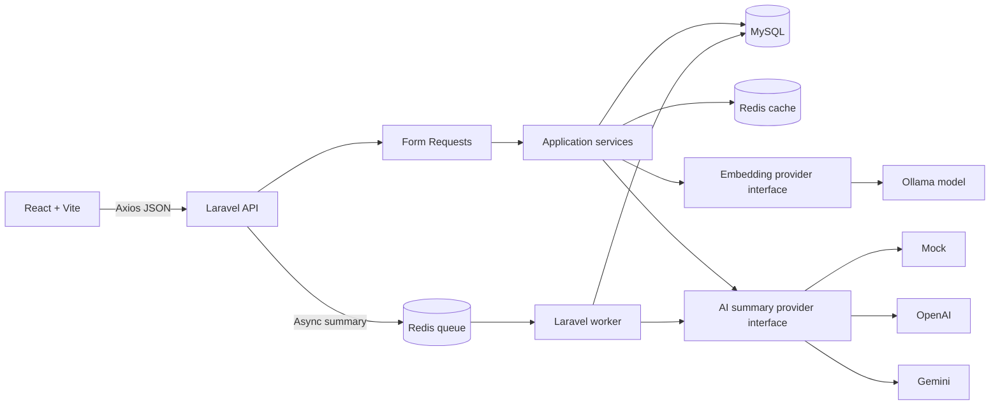
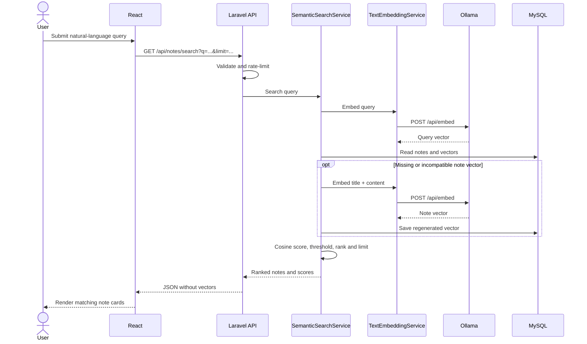

# AI Notes Manager

AI Notes Manager is a full-stack notes application with a React interface and Laravel JSON API. It supports note management, pagination, semantic search using genuine Ollama embeddings, and configurable AI summaries. This repository supports local development and Docker Compose.

## Features

- Create, browse, update, and delete notes, with pagination.
- Semantic search powered by Ollama embeddings and cosine similarity ranking.
- Summary generation using Mock, OpenAI, or Google Gemini providers.
- Synchronous summaries and an asynchronous queue endpoint with status polling.
- Dashboard statistics, note cards, and note detail page.
- Cached note list pages (60 seconds) and statistics (30 seconds), invalidated after note changes.
- Redis queue and Laravel worker support.
- Form Request validation, per-IP rate limits, CORS configuration, safe provider errors.
- Interactive OpenAPI documentation using Laravel Scramble.
- Docker Compose for Laravel, React/Nginx, MySQL, Redis, and a queue worker.
- Embedding vectors and summary status are hidden from ordinary note responses.

## Architecture

React/Vite calls Laravel through an Axios service module. Laravel validates inputs with Form Requests and delegates note, search, and summary work to services. MySQL stores notes; Ollama provides embeddings; summary providers use a separate interface. Docker uses Redis for cache and queues. Changing `AI_PROVIDER` does not change the Ollama embedding provider.



### Technology stack

Versions are taken from manifests or Dockerfiles where specified:

| Area | Technology |
|---|---|
| Backend | Laravel `^13.17`, PHP `^8.3` |
| API docs | Dedoc Scramble `^0.13.54`, OpenAPI 3.1 |
| Auth endpoint | Laravel Sanctum `^4.0` |
| Frontend | React `^19.3.1`, React Router `^7.18.5`, Vite `^8.3.6` |
| HTTP / icons | Axios `^1.21.1`, lucide-react `^1.73.0` |
| Database | MySQL; Docker image `mysql:8.4` |
| Cache / queues | Redis; Docker image `redis:7-alpine`; Predis `^3.7` |
| AI | Ollama embeddings; configurable Mock/OpenAI/Gemini summaries |
| Web server | Apache + PHP 8.3; Nginx Alpine frontend/proxy |

### Project structure

```text
backend/app/                 Controllers, Form Requests, models, jobs, providers, services
backend/config/              AI, database, cache, queue, CORS, rate limit, OpenAPI config
backend/database/migrations/ Database schema
backend/routes/api.php       JSON API routes
backend/tests/               Laravel feature and unit tests
frontend/src/components/     Reusable React components
frontend/src/hooks/          React hooks, including useNotes
frontend/src/pages/          Dashboard and note detail pages
frontend/src/services/       Axios API wrapper
docker-compose.yml           Compose services
DOCKER-SETUP.md              Detailed Docker and Ollama networking guide
```

## Installation and setup

### Prerequisites

- PHP 8.3+ compatible with Composer requirements, Composer 2, and required Laravel extensions.
- Node.js/npm compatible with the frontend toolchain (frontend Docker build uses Node `20.19-alpine`).
- MySQL and Ollama for local database and semantic search; Redis for Redis-backed caching/queues.
- Or Docker Desktop with Compose for the application/database/cache/queue. Ollama remains on the host in the supplied Compose setup.

### Clone and install backend

```bash
git clone <your-repository-url>
cd ai-notes-manager/backend
composer install
cp .env.example .env
php artisan key:generate
```

The backend `.env.example` defaults to SQLite. To use MySQL, create a local database and user (replace the sample password):

```sql
CREATE DATABASE ai_notes_manager CHARACTER SET utf8mb4 COLLATE utf8mb4_unicode_ci;
CREATE USER 'ai_notes_user'@'localhost' IDENTIFIED BY 'replace-with-a-local-password';
GRANT ALL PRIVILEGES ON ai_notes_manager.* TO 'ai_notes_user'@'localhost';
FLUSH PRIVILEGES;
```

Set these values in `backend/.env`:

```dotenv
DB_CONNECTION=mysql
DB_HOST=127.0.0.1
DB_PORT=3306
DB_DATABASE=ai_notes_manager
DB_USERNAME=ai_notes_user
DB_PASSWORD=replace-with-a-local-password
```

Set `FRONTEND_ORIGIN` and `CORS_ALLOWED_ORIGINS` to the actual frontend origin, then run migrations:

```bash
php artisan migrate
```

### Install frontend

In another terminal from the repository root:

```bash
cd frontend
npm ci
```

The API client (`frontend/src/services/noteService.js`) reads `VITE_API_BASE_URL`. For local development, set in `frontend/.env`:

```dotenv
VITE_API_BASE_URL=http://localhost:8000/api
```

Do not put server credentials in `VITE_*` variables. Docker builds the frontend with `/api`; its Nginx config proxies `/api` and `/docs` to Laravel.

### Ollama embeddings

Install Ollama, start it, and download the default model:

```bash
ollama pull nomic-embed-text
ollama list
```

Configure host Laravel in `backend/.env`:

```dotenv
EMBEDDING_PROVIDER=ollama
EMBEDDING_MODEL=nomic-embed-text
EMBEDDING_BASE_URL=http://127.0.0.1:11434
EMBEDDING_TIMEOUT=30
EMBEDDING_MIN_SIMILARITY=0.37
```

Laravel calls Ollama's `/api/embed`. The app does not download models on startup and does not fall back to hash vectors. Missing or dimension-incompatible stored vectors are regenerated during search if Ollama is available. Unavailable Ollama returns a safe service error. With Docker Desktop on macOS, use `http://host.docker.internal:11434`; see [DOCKER-SETUP.md](DOCKER-SETUP.md).

### Summary providers

`AI_PROVIDER=mock` is the default and returns deterministic preview text prefixed with `[MOCK AI SUMMARY]`; it is not model-generated. For OpenAI set `AI_PROVIDER=openai`, `OPENAI_API_KEY`, and `OPENAI_MODEL`. For Gemini, create a key in [Google AI Studio](https://aistudio.google.com/app/apikey), then configure:

```dotenv
AI_PROVIDER=gemini
GEMINI_API_KEY=your-server-side-api-key
GEMINI_MODEL=gemini-3.8-flash
GEMINI_TIMEOUT=120
```

Keep keys in backend `.env` or deployment secrets. After changing environment values run `php artisan config:clear`.

### Redis locally

On macOS with Homebrew:

```bash
brew install redis
brew services start redis
redis-cli ping
```

For Redis-backed local use configure `REDIS_CLIENT=predis`, `REDIS_HOST=127.0.0.1`, `REDIS_PORT=6379`, `CACHE_STORE=redis`, and `QUEUE_CONNECTION=redis`. Predis is already a Composer dependency; this setup does not require the PHP Redis extension.

### Docker Compose

See [DOCKER-SETUP.md](DOCKER-SETUP.md) for full details. From the repository root:

```bash
cp .env.docker.example .env.docker
```

Generate a key with `php -r 'echo "base64:".base64_encode(random_bytes(32)).PHP_EOL;'`, then set `APP_KEY` in `.env.docker`. Set unique `DB_PASSWORD` and `DB_ROOT_PASSWORD`. Build/start and apply pending migrations (Compose does not migrate automatically):

```bash
docker compose --env-file .env.docker up --build -d
docker compose --env-file .env.docker exec backend php artisan migrate --force
```

## Running the application

Start the configured MySQL, Ollama, and Redis services. Use separate terminals:

**Terminal 1 — Laravel API** (from `backend/`):

```bash
php artisan serve --host=127.0.0.1 --port=8000
```

**Terminal 2 — React/Vite** (from `frontend/`):

```bash
npm run dev
```

**Terminal 3 — Redis queue worker** (from `backend/`, for async summaries):

```bash
php artisan queue:work redis --sleep=3 --tries=3 --timeout=120
```

Local default URLs are UI `http://localhost:5173` and API `http://localhost:8000`. In Docker, Compose defaults are UI `http://localhost:8080`, backend port `8000` (configurable via `BACKEND_FORWARD_PORT`), MySQL host port `3307`, and Redis internal-only. Compose starts a separate queue worker automatically:

```bash
docker compose --env-file .env.docker up -d
docker compose --env-file .env.docker ps
docker compose --env-file .env.docker logs -f backend frontend mysql redis queue
docker compose --env-file .env.docker down
```

`down` preserves data volumes. Avoid `down -v` unless intentionally removing stored MySQL/Redis data.

## API documentation and endpoints

With Laravel running, Scramble UI is [`http://localhost:8000/docs/api`](http://localhost:8000/docs/api) and OpenAPI JSON is [`http://localhost:8000/docs/api.json`](http://localhost:8000/docs/api.json). Use the configured backend port for Docker.

| Method and path | Purpose and inputs | Success response |
|---|---|---|
| `GET /api/notes` | Paginated newest-first list; `page` ≥1, `limit` 1–100 (default 10) | `200`: `success`, `message`, Laravel paginator in `data` |
| `POST /api/notes` | JSON: required `title` ≤255 chars; required `content` ≤50,000 chars | `201`: `success`, `message`, `data` note |
| `GET /api/notes/{note}` | Get note by integer ID | `200`: `success`, `data` note |
| `PUT/PATCH /api/notes/{note}` | Optional `title` and/or `content`; at least one required | `200`: `success`, `message`, `data` note |
| `DELETE /api/notes/{note}` | Delete by integer ID | `200`: `success`, `message` |
| `GET /api/notes/search` | `q` required 2–500 chars; `limit` 1–100 default 10 | `200`: ranked `data` entries `{note, similarity_score}` |
| `GET /api/notes/stats` | Statistics | `200`: `data: {total_notes, ai_summaries, recent_notes}` |
| `POST /api/notes/{note}/summary` | Generate synchronously | `200`: `success`, `message`, `data: {note_id, summary}` |
| `POST /api/notes/{note}/summary/async` | Queue summary | `202`: `success`, `message`, `data: {note_id, status}` |
| `GET /api/notes/{note}/summary/status` | Poll async summary state | `200`: `success`, `data: {note_id, status, summary?}` |
| `GET /api/user` | Sanctum bearer token required | `200` user; `401` unauthenticated |

Example create:

```bash
curl -X POST http://localhost:8000/api/notes \
  -H 'Accept: application/json' -H 'Content-Type: application/json' \
  -d '{"title":"Weekend plans","content":"Find a trail and prepare for a day hike."}'
```

Example search:

```bash
curl --get 'http://localhost:8000/api/notes/search' \
  --data-urlencode 'q=planning a weekend outdoors' --data-urlencode 'limit=5'
```

Example response shapes (timestamps abbreviated only where not relevant):

```json
{"success":true,"message":"Notes fetched successfully","data":{"current_page":1,"data":[{"id":42,"title":"Weekend plans","content":"Find a trail and prepare for a day hike.","summary":null,"created_at":"2026-11-16T10:00:00.000000Z","updated_at":"2026-11-16T10:00:00.000000Z"}],"per_page":10,"total":1,"last_page":1}}
```

```json
{"success":true,"message":"Semantic search completed successfully.","data":[{"note":{"id":42,"title":"Weekend plans","content":"Find a trail and prepare for a day hike.","summary":null,"created_at":"2026-11-16T10:00:00.000000Z","updated_at":"2026-11-16T10:00:00.000000Z"},"similarity_score":0.82}]}
```

```json
{"success":true,"message":"Summary generation queued.","data":{"note_id":42,"status":"pending"}}
```

Synchronous summary response:

```json
{"success":true,"message":"Summary generated successfully.","data":{"note_id":42,"summary":"A concise overview of the note."}}
```

Statistics response:

```json
{"data":{"total_notes":12,"ai_summaries":4,"recent_notes":3}}
```

Common errors: `401` unauthenticated `/api/user`; `404` note missing; `409` summary already pending/processing; `422` invalid input or empty note; `429` rate limit (`Retry-After` header); `502` summary provider failure; `503` embedding or queue unavailable; `500` unexpected error. Validation responses use Laravel's `message` and `errors`. Vectors and internal status are not returned in note JSON.

Default per-IP limits: normal API `60/min`, search `10/min`, summary endpoints `5/min`. Configure with `API_RATE_LIMIT_PER_MINUTE`, `SEMANTIC_SEARCH_RATE_LIMIT_PER_MINUTE`, `AI_SUMMARY_RATE_LIMIT_PER_MINUTE`.

### Semantic search request flow



## Database schema

Notes schema from migrations in `backend/database/migrations`:

| Field | Type | Details |
|---|---|---|
| `id` | Unsigned big integer | Auto-increment primary key |
| `title` | `VARCHAR(255)` | Required, indexed |
| `content` | `LONGTEXT` | Required; request max 50,000 chars |
| `summary` | Nullable `TEXT` | Generated summary |
| `summary_status` | Nullable `VARCHAR(20)` | Queue state; hidden from normal note JSON |
| `embedding` | Nullable `JSON` | Vector array; hidden from normal note JSON |
| `created_at`, `updated_at` | Timestamps | Laravel-managed timestamps |

There is no note-to-user relationship or user foreign key in the notes table. Laravel support migrations also define users, personal access tokens, cache, jobs, and failed jobs.

## AI integration

`AIProviderInterface` defines the summary contract; `AIService` delegates to the provider selected in `AppServiceProvider` through `AI_PROVIDER`:

| Provider | Behavior | Configuration |
|---|---|---|
| `mock` | Deterministic `[MOCK AI SUMMARY]` preview; not genuine AI | Default, no key |
| `openai` | OpenAI model-generated summary | `OPENAI_API_KEY`, `OPENAI_MODEL` |
| `gemini` | Google Gemini `generateContent` summary | `GEMINI_API_KEY`, `GEMINI_MODEL`, `GEMINI_TIMEOUT` |

Embedding uses its own `EmbeddingProviderInterface`, currently Ollama. On note create/update the app embeds `title + content`; search embeds the query and compares vectors using cosine similarity. It filters scores below `EMBEDDING_MIN_SIMILARITY` (default `0.37`), sorts highest first, applies the requested limit, and returns scores without vectors. Raise or lower the cutoff for your model and note collection. Re-embed existing notes when changing embedding models so vectors share a model space.

Async summaries use the `GenerateNoteSummary` queue job, mark status, retry up to three times with backoff, store successful summaries, and expose status through the polling endpoint. Docker starts a worker service. The React frontend currently uses synchronous summary generation; async support is available through the API but is not wired into the UI.

## Security

- Form Requests validate note fields, search queries, and pagination bounds.
- Note persistence uses Eloquent; search text is embedded as data, not interpolated into SQL.
- Embeddings and internal summary status are model-hidden.
- CORS origins are configured from `CORS_ALLOWED_ORIGINS` / `FRONTEND_ORIGIN`; set the exact frontend origin.
- Provider credentials belong in backend environment/deployment secrets. Never put them in `VITE_*` variables or commit `.env` files.
- Provider errors are sanitized; summary logs include note ID and exception class rather than provider body or key.
- Laravel named rate limiters protect API, search, and summary routes.

## Testing

From `backend/`:

```bash
php artisan test
vendor/bin/pint --test
```

From `frontend/`:

```bash
npm run lint
npm run build
```

Feature tests cover CRUD/validation, search, stats, summaries, cache invalidation, queue behavior, rate limits, OpenAPI docs, and Gemini handling. External Gemini HTTP responses are mocked, so tests do not need an API key or paid credits. Ollama provider tests can mock HTTP; a live semantic-search check needs Ollama and the model installed.

## Environment variables

Use [`backend/.env.example`](backend/.env.example) for host Laravel and [`.env.docker.example`](.env.docker.example) for Compose. They are templates; do not copy real values from local `.env` files into source control.

| Variables | Purpose | Safe sample/default |
|---|---|---|
| `APP_ENV`, `APP_DEBUG`, `APP_KEY`, `APP_URL` | Laravel runtime | local, true, generated key, localhost |
| `DB_CONNECTION`, `DB_HOST`, `DB_PORT`, `DB_DATABASE`, `DB_USERNAME`, `DB_PASSWORD` | Database | MySQL; host `127.0.0.1` local / `mysql` Compose |
| `CACHE_STORE`, `QUEUE_CONNECTION` | Cache/queue backends | Local template defaults; Compose uses Redis |
| `REDIS_CLIENT`, `REDIS_HOST`, `REDIS_PASSWORD`, `REDIS_PORT`, `REDIS_DB`, `REDIS_CACHE_DB`, `REDIS_QUEUE` | Redis | Predis; localhost local / `redis` Compose |
| `FRONTEND_ORIGIN`, `CORS_ALLOWED_ORIGINS` | Browser allowlist | local `http://localhost:5173`; Compose `http://localhost:8080` |
| `VITE_API_BASE_URL` | Frontend API base URL | local `http://localhost:8000/api`; Compose `/api` |
| `AI_PROVIDER` | Summary implementation | `mock` (default), `openai`, or `gemini` |
| `OPENAI_API_KEY`, `OPENAI_MODEL` | OpenAI summary | Secret key and account model ID |
| `GEMINI_API_KEY`, `GEMINI_MODEL`, `GEMINI_TIMEOUT` | Gemini summary | blank key, `gemini-3.8-flash`, `120` seconds |
| `EMBEDDING_PROVIDER`, `EMBEDDING_MODEL`, `EMBEDDING_BASE_URL`, `EMBEDDING_TIMEOUT` | Embeddings | ollama, nomic-embed-text, local URL, 30 |
| `EMBEDDING_MIN_SIMILARITY` | Search result threshold | `0.37` |
| `API_RATE_LIMIT_PER_MINUTE`, `SEMANTIC_SEARCH_RATE_LIMIT_PER_MINUTE`, `AI_SUMMARY_RATE_LIMIT_PER_MINUTE` | Limits per IP | `60`, `10`, `5` |

Docker port and DB settings are in `.env.docker.example`. Protect app keys, database passwords, and AI keys as secrets.

## Screenshots and demo

Place screenshots in `docs/screenshots/` and replace the placeholders. No screenshots or public demo URL are currently present in the repository.

| Screen | Placeholder |
|---|---|
| Dashboard | `` |
| Note details | `` |
| AI summary | `` |
| Semantic search | `` |
| Swagger UI | `` |

## AI tools and prompts used

Codex was used as an AI coding assistant during development. AI-assisted changes were reviewed against the existing provider contracts, API routes and response shapes, then tested. Gemini integration uses mocked HTTP tests. The repository does not identify other AI tools or retain a canonical prompt log; contributors can add any additional tools and prompts used here.

## Future improvements

- Add per-user note ownership and authorization before multi-user use; notes currently have no owner relationship.
- Wire frontend loading/polling UI to the existing async summary API; the UI currently uses synchronous summaries.
- Add a controlled command for re-embedding notes during embedding model changes.
- Add deployment-specific HTTPS, monitoring, and backup instructions for a selected hosting provider.

## License and author

**License:** Not specified. Add a `LICENSE` file when selected.

**Author:** Not specified. Replace this placeholder with the project author's preferred name and profile/contact link.
